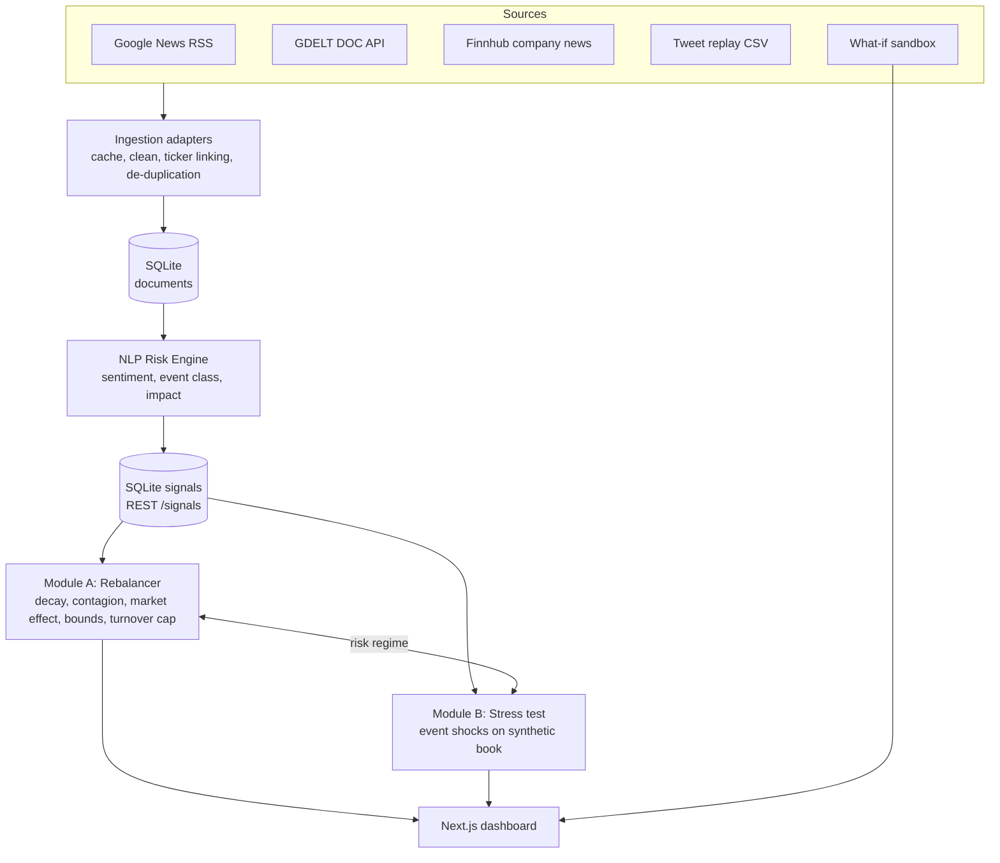

# RiskPulse: AI/NLP Risk Engine with Tactical Rebalancing and Event-Driven Stress Testing - S&P Global & Crisil Campus Hackathon

**Candidate Name:** Shivangi Bisht

**College Email ID:** shivangi185btcseai24@igdtuw.ac.in

**College / Campus:** Indira Gandhi Delhi Technical University for Women

**Demo Video Link:** [\[YouTube unlisted link\]](https://youtu.be/EB2u-bm1iiA)

**Slide Deck Link (if hosted externally):** [\[presentation link\]](https://drive.google.com/file/d/1VTJw0oq697NcqbUNJYUfujPqbSNOgRS0/view?usp=sharing)

## 1. Project Overview / Problem Statement & Approach

Financial risk now moves at the speed of headlines, but most of the signal sits in unstructured text: news wires, social media, geopolitical reports. This project builds a **unified AI/NLP Risk Engine** that ingests text from several sources, links it to companies, and converts it into structured, machine-readable risk signals: a **sentiment score** (-1 to 1), an **event classification** (Geopolitical, Macroeconomic, Credit Event, Merger/Acquisition, Regulatory, Earnings, Product Launch) and an **impact score** (1-10), each with confidence and an evidence trail.

**NOTE**: Both Module A and Module B are implemented and fully functional with advanced models. 

Both downstream modules are implemented on top of the same engine, covering two time horizons: **Module A** is a tactical, event-driven rebalancer for a mock 18-stock index; **Module B** is a strategic stress-testing tool that revalues a synthetic wholesale-banking book (loans, bonds, derivatives, equity) whenever a high-impact event is detected.

Beyond the brief, the prototype adds four features aimed at making the output explainable and demo-able: **explainable impact scores**, **contagion spillover** between same-sector stocks, a **unified risk-regime switch** that links the tactical and strategic modules, and a **what-if sandbox with crisis-replay scenarios** (see "Distinctive features" below).

## 2. Architecture & Tech Stack



- **Backend:** Python, FastAPI, SQLite, pandas, httpx. **Frontend:** Next.js (React, TypeScript, Tailwind), hand-built SVG charts (no chart library).
- **NLP:** sentiment via **FinBERT** (`ProsusAI/finbert`, optional) with an automatic fall-back to a finance lexicon scorer (negation and intensity handling) so the pipeline always runs; event classification via a weighted regex taxonomy (optional zero-shot BART-MNLI backend); impact via an explainable composite formula.
- **Impact score** = `clamp(round(1 + 9 × severity × magnitude × credibility × corroboration), 1, 10)`, where severity is the event type's base severity, magnitude is `0.5 + 0.5·|sentiment|`, credibility reflects the publisher (wire services > blogs > tweets) and corroboration rewards multiple independent mentions. Every signal stores this breakdown.

### Distinctive features

1. **Explainable signals.** Each signal carries its evidence (headline), model backend, confidence and the full impact-score breakdown; the dashboard shows "why" for every score and every weight.
2. **Contagion graph.** A high-impact shock at one stock spills over to its same-sector peers (e.g. a credit event at one bank lowers the effective sentiment of the other banks), and macro / geopolitical signals move the whole index scaled by sector beta.
3. **One engine, two horizons.** A stress index (decayed, impact-weighted negative news) defines a NORMAL / ELEVATED / CRISIS regime. In stress the rebalancer rotates away from high-beta sectors, while Module B is triggered automatically for the dominant high-impact event.
4. **What-if sandbox and crisis replay.** Type any headline, or replay a synthetic crisis (bank run, oil shock, hawkish central bank, tech antitrust, earnings rally) and watch signals, weights, regime and the stress test update live. Sandbox data is tagged and can be reset without touching real data.

### Repository layout

```
app/                  Next.js frontend: landing page (/) and dashboard (/dashboard/*), components/, lib/
backend/app/          FastAPI service: ingestion/ (adapters), engine/ (NLP, rebalancer, stress, sandbox)
backend/scripts/      generate_data.py (reproducible synthetic data)
data/                 portfolio.csv, sample_tweets.csv, shocks.json, scenarios.json
docs/                 presentation.pdf, architecture.png
```

## 3. Dataset Used

| Data | Source / nature | Where |
|---|---|---|
| News headlines | Public: Google News RSS, GDELT DOC 2.0 API, Finnhub company news (optional free key). Fetched live, cached to `backend/data/cache` | runtime |
| Tweets | **Synthetic** sample of 183 stock tweets generated by `backend/scripts/generate_data.py` (same columns as the Kaggle "Stock Tweets for Sentiment Analysis and Prediction" dataset). The full Kaggle CSV can be dropped in as `backend/data/stock_tweets.csv` and is picked up automatically | `data/sample_tweets.csv` |
| Portfolio | **Synthetic** wholesale-banking book: 60 assets (20 loans, 18 bonds, 10 derivatives, 12 equities), seed 42 | `data/portfolio.csv` |
| Shock table, scenarios | Hand-defined modelling assumptions and synthetic headlines | `data/shocks.json`, `data/scenarios.json` |

Assumptions: sector betas (Financials 1.2, Technology/Consumer Discretionary 1.1, Energy 1.0, Healthcare 0.7, Staples 0.6) and shock sizes are illustrative, not calibrated; credit-loss revaluation uses a simplified PD-uplift model; no real client or confidential data is used.

## 4. Quickstart & Installation

Runtime: Python 3.10+ (tested on 3.12) and Node 20+ on [OS tested, e.g. Windows 11]

```bash
git clone <your-repo-url>
cd <repo-folder>

# Terminal 1 - backend (http://localhost:8000/docs)
cd backend
python -m venv .venv
source .venv/bin/activate          # Windows: .venv\Scripts\activate
pip install -r requirements.txt
cp .env.example .env               # optional: add FINNHUB_API_KEY
uvicorn app.main:app --reload

# Terminal 2 - frontend (http://localhost:3000), from the repo root
npm install
npm run dev
```

Then open http://localhost:3000 (landing page) and click **Open dashboard**:
1. **Ingestion**: click *Ingest all* (tweets + live news; scoring runs automatically).
2. **Sandbox**: run *Regional bank run* and watch signals, weights, regime and the stress test update.
3. **Overview**, **Rebalancer** and **Stress test** show the current regime, weight history with contagion, and the before/after portfolio value.

Optional: `pip install -r requirements-ml.txt` enables real FinBERT sentiment (first run downloads the model). Set `OFFLINE_MODE=1` in `backend/.env` to serve only cached responses for a network-free demo. Regenerate the synthetic data with `python backend/scripts/generate_data.py`.

## 5. Key Results & Domain Impact

- **What it outputs:** structured risk signals (`GET /signals`), live index weights with explanations (`GET /rebalance/current`, `/rebalance/timeline`), and event-triggered stress-test results (`GET /stress/auto`, `POST /stress/run`).
- **Results:** [add your measured results here: sentiment accuracy/F1 on a labelled sample, rebalancer backtest vs equal-weight, example stress-test loss for the bank-run scenario].
- **Why it matters:** risk and portfolio teams need to react to events within minutes, yet event impact is usually judged manually. The engine turns raw text into consistent, auditable signals and connects them to two concrete actions: tilting an index tactically and quantifying strategic exposure of a banking book, with a regime switch tying the two together.

### Limitations and next steps

Headline-level text only (GDELT and Google News expose titles, not bodies); the lexicon fallback is weaker than FinBERT on sarcasm and context; impact scoring and shock sizes are heuristic and should be calibrated against realised returns and historical stress episodes; the stress model is deliberately simple (no netting, correlation or second-order effects). Next: calibrate impact against next-day abnormal returns, add article-body NLP, and learn the contagion graph from return correlations.
